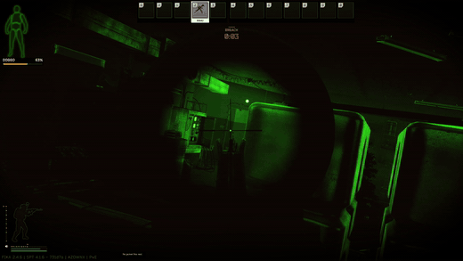
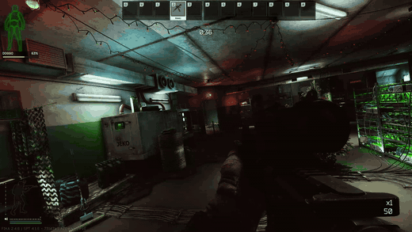
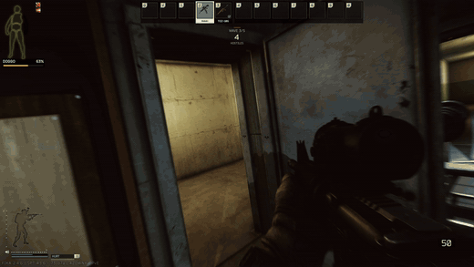
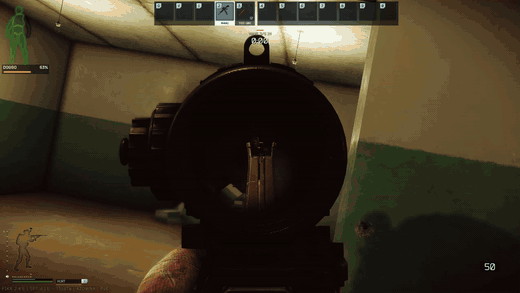
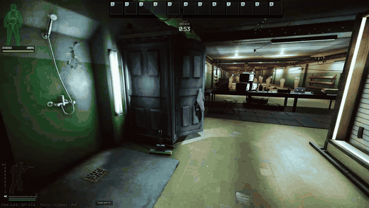
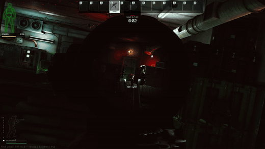
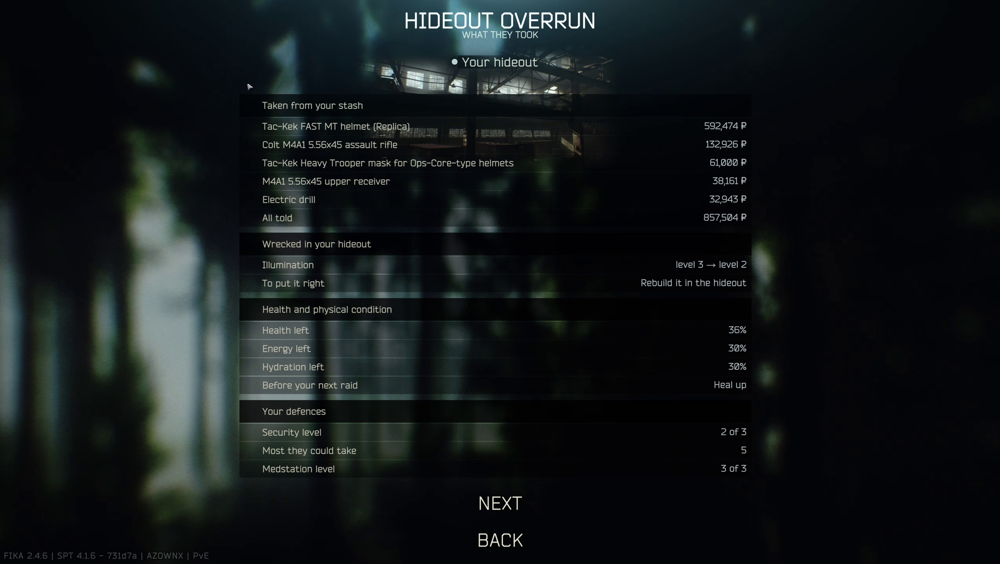

# Tushonka: Hideout Last Stand

Your hideout gets attacked. An alert appears on the menus, you click **Start the Defense**, and you load into a raid set in your own hideout, with your stations at their real levels and your chosen walls, floor and ceiling. A security camera shows a scav coming down the stairs and setting a charge on your front door. You wake up in the Rest Space with a minute to get your guns off the weapon rack and your gear off the gear rack, then the door blows and they come through in waves. The stronger your defences, the tougher they get.

For SPT 4.1. Works alone or with Fika.

## What you need

| Mod | Needed? | What it does here |
|---|---|---|
| **SPT** 4.1 | **Required** | |
| **[Hideout Interiors](https://github.com/JRS-Mods/HideoutInteriors)** 0.2.0+ | **Required** | Its decor panel's **Defences** tab is where you place sandbags, steel barricades, barbed wire and the mounted gun. Your moved, hidden and decorated things are in the siege as you left them. Without it, this mod doesn't load. |
| **Fika** | Optional | Co-op: the host runs the siege and everyone defends the host's hideout. Everyone needs the same version of this mod. A Fika headless can host it too: it's your hideout they attack. |
| **[Hideout Extensions](https://github.com/JRS-Mods/HideoutExtensions)** 1.3+ | Optional | Only needed if you want them to breach through other walls: with its rooms built, they tunnel up to one and blow through its wall. Without it, their second way in is your Emergency Wall door. Your built rooms are in the siege too. |
| **SAIN** 4.5 (with BigBrain) | Optional | Smarter attackers. The siege steers them towards you when SAIN would have them sit in cover. |
| **Black Division** | Optional | One of the last waves you can get, from 50% defences. Without it, Raiders and Rogues come in their place. |
| ↳ MoreBots (with its patcher), WTT CommonLib, WTT ContentBackport, SAIN | Needed by Black Division | Black Division won't load without all of these, and you get Raiders and Rogues. |
| WTT Armory | Works alongside | Tested with it installed. Black Division has loadouts that use it. |
| ORBIT | Works alongside | Its bot brain stays out of the siege. Your other raids aren't affected. |
| Bot Placement System, Waypoints | Works alongside | Tested with them installed. Nothing to set up. |
| Tushonka Territories | Works alongside | Its faction spawns and kill counter stay out of the siege. Your other raids aren't affected. |

## How a siege goes

1. **The alert.** When your hideout is invaded, a banner appears on the menus. Click **Start the Defense**, or **Later** to hide it until your next raid. When you're not under attack, the main menu shows a countdown to the next one. In co-op, the host starts it and the others join through Fika's server browser as usual.
2. **The security camera.** A few seconds: a scav walks down the stairwell to your front door with his gun on his back and the charge in his hand, sets it on the door and walks back up. The feed cuts out and you wake up by the bed. Space skips it. Nobody can be hurt while it plays.
3. **Get ready.** You have 60 seconds. Your guns and spare magazines are on the weapon racks, and your armour, rig, backpack and helmet are at the gear rack, with everything still in them. Just pick them up: nothing needs searching. Guns are ready to fire, with your fullest spare magazine in and a round chambered. Meds and injectors are in your pockets where they fit, so their quick slots stay set. Haven't built a weapon rack yet? You keep your guns on you. No gear stand? You keep your armour, rig, backpack and helmet on. So you can defend from your first day. The door is locked until the charge goes off, and it beeps for the last 10 seconds.
4. **The breach.** The door blows, and so does the gate of the cultist room at the top of the stairs: the attackers have been waiting past it, out of sight, and they come through the cultist room, down the stairwell and through the front door. They know you're there. Each wave ends when all its attackers are dead, then you get 25 seconds to heal, reload and loot.
5. **The end.** Hold through the last wave and you have a minute to loot (and put what you want in your stash box: see [What it costs and pays](#what-it-costs-and-pays)) before you leave as **Survived**. Press F10 to leave sooner. If everyone dies, the raid ends as a normal death.

The door is whichever one your Security level has: wood, grille or steel. An unbuilt Security station gets the wood one. You can make it hold out longer: see [Upgrading the front door](#upgrading-the-front-door).



**The dark.** When the last wave is Black Division, they cut the power a few seconds before they come in ("THEY'VE CUT THE POWER"): every light goes out for everyone, and the mounted gun stops minding the door by itself (you can still work it). It stays cut for the rest of the raid: the generator won't switch back on. Before that, with a generator built, you can switch the power off yourself (walk up to it and use it) and back on whenever you like, and the dark is worth it against scavs: they've nothing but the light on their gun, if they have one, and can't see past 20 metres by it. A scav without one is all but blind. Black Division (and Raiders and Rogues standing in for them) come with night vision (on their helmet's mount, or a head-strap set if they've no helmet), down while it's dark. You'll want a flashlight or night vision of your own.



**Blasts hurt.** Within 16 metres you're concussed for a while, and within 12 metres with a clear view you're blinded for a few seconds. Within about 4 metres on the charge's side you're wounded too, badly up close (the attackers aren't hurt by their own charges); the door or barricade it's on shields whoever's behind it. Don't stand and watch the door.



**Shutting a door won't save you.** If a closed door is the only thing keeping attackers from you, one of them walks up, sets a charge on it and backs off, and it blows 5 seconds later. Whoever's sent to do it is one who can't see any of you, and if one of you comes into sight on his way he drops it and fights. "THEY'RE BREACHING" shows when he's at the door and kneeling to set it. Kill him before the charge is on (on his way, or while he kneels) and there's no breach ("BREACH STOPPED" if he'd started setting it), for a few seconds until the next one tries; once it's on, it goes off whatever happens to him. A charge only ever goes on by hand: one who can't get to the door gives up and another tries.



**Bring your own armoury.** Whatever is on your real weapon racks is on them in the siege, and your mannequins stand there dressed in their loadouts. Walk up to one to take a piece at a time or the lot with one press. You also get up to 4 spare magazines per gun from the top level of your stash, as long as they fit. Set your racks up in the real hideout before you start. Only what you take is at risk: pick something up and die, and it's gone, but anything left on the racks stays yours. In co-op, it's the host's racks.



**Your hideout fights back.**
- **Spare magazines:** with no room for a magazine on a rack, you're offered a swap for your emptiest one, which drops on the floor.
- **Medstation and Nutrition Unit:** use each one once per break. Medstation levels 1 to 3 heal 40%, 70% or everything, and the Nutrition Unit restores 30, 60 or 100 energy and hydration.
- **Defences:** Hideout Interiors' decor panel has a **Defences** tab. Put them where you like in your hideout and they're there in the siege. A hideout can only have so many of each (the panel shows how many you've got in), so you can't wall the place up solid. Nobody gets over sandbags or a steel barricade, you or the attackers. Attackers go round them where they can; where a wall of them shuts them out, they gather in front of it (fighting you over it if they can see you) and one of them walks up to the piece in the way, sets a charge on it and blows it, as they do a shut door ("THEY'RE BREACHING YOUR DEFENCES" once he's kneeling at it, the red lamp and a 5 second fuse; kill him before the charge is on and there's no breach), and the way's open for everyone after. Anything solid you put in a doorway, or out by the front door or on the stairs, sits the siege out.

  | | Most | In the siege |
  |---|---|---|
  | Sandbags | 6 | Chest high. They stop bullets, and attackers go round them. |
  | Steel barricade | 3 | Taller than you, with a firing slit at eye height: nothing gets through the plate, but you can see and shoot through the slit (and so can they). Stand between its props, right up against it. Attackers go round it. |
  | Barbed wire | 4 | Stops nothing, but anyone in it can't run, slows to a crawl and gets their legs cut as they push through. Attackers don't go round it, so put it where you want them held up in your sights. It catches you too. |
  | Mounted gun | 1 | See below. |
- **Mounted gun:** at Security level 2 or higher, a heavy machine gun, if you've put one in: Mounted gun is in Hideout Interiors' decor panel, Defences tab, and the one you place is where it stands, facing the way you turned it. Without one placed, there's no gun. While nobody's on it and the power's on, it minds the door by itself: it slowly swings to the nearest attacker it can see within 24 metres, takes a second to settle, and fires short, loose bursts: 30 rounds a wave, topped up every break, and never with one of you in the way. It holds them up rather than clearing the room; someone on it does far better. Walk up and use **Operate** to take it over.
- **Second way in:** from wave 2, about half of each wave comes another way. With Hideout Extensions' rooms built, they've dug a tunnel up to the wall of one of them, a room picked at random each invasion (one well away from the front door, where there's a choice): as that wave starts, the wall's blown and they come through it. The hole's ragged and scorched, and through it there's a dug tunnel with a bank of earth across it; they wait round the far side of the bank, out of your sight. You can't go into the tunnel, or past the cultist room's gate where the rest wait: walking in stops you where you were. The tunnel is never dug right alongside another room. Otherwise, if your Emergency Wall still has its door shut with nothing but that door leading past it, they blow it from the far side. In a hideout built out past the wall, where the far side is one of your own rooms, or if you could see them waiting there, nobody comes that way and the whole wave comes by the front door. Either way there's a warning and a short fuse, and there's never more than the one: the front door and this.

  

**Watch the red lamp.** A charge's lamp blinks and beeps faster as it counts down, and stays on just before it goes off.

**Attackers load up front.** Everyone the whole siege will send is loaded on the loading screen, which makes it about 10 seconds longer, so the game doesn't freeze when a wave arrives. Each wave then comes in during the break and waits out of sight: past the cultist room's gate, and in the tunnel or behind the Emergency Wall for those coming the second way. Leaving by the blown door during a break, or shooting one of them while they wait, starts the wave straight away.

## Losing

If you die in the siege, you lose what you carried, as in any raid, and more: while you were down they went through your stash, your weapon racks and your mannequins and took the most valuable things, wherever they were (not money, and not cases with things in them), they wrecked part of your hideout on the way out, and you come round badly hurt (and hungry and thirsty), so you'll want to heal up before your next raid. In the end-of-raid screens, after your experience and before the one to heal up, **Hideout Overrun** shows what they took (and what it was worth), what they wrecked, the state you came round in and what your Security and Medstation did for you; there's a message with it in your mail too.



The better defended the hideout they broke into, the more they take; a better Security station keeps more of it safe.

| Things taken from your stash, racks and mannequins | Security 0 | 1 | 2 | 3 |
|---|---|---|---|---|
| Defences under 25% | 3 | 2 | 2 | 2 |
| Defences 25-49% | 4 | 3 | 3 | 2 |
| Defences 50-74% | 5 | 4 | 4 | 3 |
| Defences 75%+ | 6 | 5 | 5 | 4 |

**Wrecked:** one of these goes down a level, picked at random from those they can: your Security, Vents or Illumination (never below level 1), or your front door's top upgrade. You rebuild it as you built it. Nothing else is touched: these stations hold nothing, make nothing and give no lasting bonus, so all you lose is the level.

| | Medstation 0 | 1 | 2 | 3 |
|---|---|---|---|---|
| Health left | 12% | 20% | 28% | 36% |

## Upgrading the front door

In your hideout, walk up to the front door from inside and look at it: your interact key shows the next upgrade, what it costs, what you have of each, and how long it takes. It's built like a hideout upgrade, from your stash.

| Upgrade | Needs | Cost | Build time | In a siege |
|---|---|---|---|---|
| Reinforced front door | Security level 2 | 75,000 roubles, 4 bolts, 2 packs of nails, 1 toolset | 1 h | The first charge doesn't bring it down: another goes on, about 14 seconds later |
| Barred front door | The reinforced door, Security level 3 | 150,000 roubles, 6 bolts, 3 packs of nails, 2 packs of screws, 1 electric drill | 2 h | It takes a third charge |

Steel bars across the inside of the door show how much it's got left, and "THE DOOR HELD" tells you when a charge didn't do it. In co-op it's the host's door.

## What it costs and pays

It's a real raid, so **you bring your own gear and lose it if you die**. Anything you leave on the floor stays there when you leave, and attackers will pick up what they find.

**Holding the hideout pays in what they brought.** There's no reward by message: you keep what you loot from the attackers. After the last wave you have a minute to strip them, and there are two ways to keep more than you can carry:

- **Your stash box:** walk up to the Stash station and **Open stash**. It's an empty box, 10 by 6 unless you change it (see [Settings](#settings)), and whatever you put in it is in your real stash afterwards. It works between waves too. **It's only kept if the hideout holds:** if you go down but the others hold out, what's in your box is still yours, and if everyone dies the attackers have every box. If your stash is full, what doesn't fit comes by message instead. You can't get at your real stash from the siege: you fight with what you brought and what's on your racks. In co-op every player has a box of their own, and what's in it goes to their own stash.
- **Bags from your racks:** fill a backpack or rig from your gear stands and drop it anywhere in the hideout, then fill the next: what you put in them goes into your stash afterwards, and the bags stay on your stands as they were.
- **Your own gear:** after holding out, anything of your own that you left lying in the hideout (the gear you came in with, laid out on the racks, and whatever you've stuffed in it) goes into your stash too. Lose, and it's lost, as in any raid.

**In co-op it's the hideout of whoever started the defence.** If they die, they pay for it: what they carried, and what's taken, wrecked and done to them (see [Losing](#losing)). A friend who dies helping loses what they carried in, as in any raid, and comes round as badly hurt as the owner would (less with a better Medstation of their own). Their own stash and hideout aren't touched, and the result doesn't count towards their own invasions. The bags from the racks and the gear left lying are only kept for the player whose hideout it is.

**Ask before you take.** What's on the racks and mannequins belongs to someone: the hideout's gear to whoever's hideout it is, and what each player came in with to that player. Look at something of another player's and you get **Ask ... for this** in place of Take. They see who's asking and for what, and press F7 to allow or F8 to decline (see [Settings](#settings)); no answer in 20 seconds and you can ask again. Once its owner is dead, anyone can take it.

## Threat levels

Your defence rating comes from Security, Emergency Wall, Intelligence Center, Shooting Range, Generator and Illumination, with Security counting most.

| Defences | Who comes | Waves | Attackers in all |
|---|---|---|---|
| Under 25% | 2 scavs · 2 scavs, 1 Raider · last wave | 3 | 4 + the last wave |
| 25-49% | 2 scavs, 1 Raider · 1 scav, 1 Raider, 1 PMC · last wave | 3 | 6 + the last wave |
| 50-74% | 2 scavs, 1 Raider · 2 Raiders, 2 PMCs · 2 Smugglers, 1 Rogue · last wave | 4 | 14 |
| 75%+ | 2 scavs, 1 Raider · 2 Raiders, 2 PMCs · 1 PMC, 2 Smugglers · 2 Smugglers, 2 Rogues · last wave | 5 | 19 |

"Attackers in all" counts Black Division as the last wave from 50% up (below that they don't come); a boss's wave is the size the table below gives.

**In co-op the waves are bigger.** Each wave is 50% bigger for every player after the first, counted as the siege starts: two of you face waves one and a half times the size, four of you two and a half times (19 attackers become 48 at the top level). One more attacker comes at a time for each extra player too, up to 10. The host's setting decides (see [Settings](#settings)); 0 turns it off. The extra attackers aren't known about on the loading screen, so they load as each wave gathers during the break.

Every siege builds the same way: mixed waves that get harder (scavs with a Raider among them, then Raiders and PMCs, then Smugglers and Rogues), and then the last wave. The banner says who's coming the first time they turn up. Smugglers are the game's own (the bots Acid's Bot Placement System calls Smugglers), so they need no other mod.

**The last wave is a roll of the dice.** Each invasion it's one of the bosses with his people, or Black Division, as likely as the **Last wave** sliders say (see [Settings](#settings)). Black Division are stronger than any boss, so they only come once your defences reach 50%; below that it's always a boss, and an easier one with weaker defences. The banner names who's coming:

| Last wave | Who comes | From defences |
|---|---|---|
| Black Division | 4 of them, or 5 at 75%+ | 50% |
| Reshala | Reshala, 2 guards and 3 scavs | Any |
| Killa | Killa, alone | 25% |
| Tagilla | Tagilla, alone | Any |
| Sanitar | Sanitar, 2 guards and 2 scavs | 25% |
| Glukhar | Glukhar, 3 guards and 2 Raiders | 50% |
| Kaban | Kaban, 3 guards and 2 scavs | 50% |
| Kollontay | Kollontay, 3 guards and 2 scavs | 50% |
| The Goons | Knight, Big Pipe and Birdeye | 75% |

Only Black Division cut the power: a boss's wave leaves the lights on.

**Bosses in co-op.** A boss's scavs or Raiders grow with the number of you like any wave, but there's still one boss and the guards he had. He has more health instead, by as much as the waves have grown: one and a half times with two of you, two and a half with four. That's how Killa and Tagilla, who come alone, keep up with a bigger group.

**Black Division** is TacticalToaster's mod (its assault troops and raiders). Without it, Raiders and Rogues come instead. Black Division needs MoreBots (with its patcher in `BepInEx/patchers`), SAIN 4.5, WTT CommonLib and WTT ContentBackport; if any is missing it doesn't load, and you get Raiders.

## Other mods

What you need is in the table at the top ([What you need](#what-you-need)). In more detail:

- **SAIN:** attackers run on SAIN if it's installed. SAIN's bots hold cover while they can't see you, so the siege takes over an attacker that hasn't seen any of you for a few seconds and walks it toward the nearest of you, blowing doors on the way; once one of them has noticed you, SAIN fights. Smugglers fight with SAIN too: SAIN doesn't give them its fighting by itself, so the siege has it do so. This uses BigBrain, which SAIN needs anyway.
- **Bot mods with gear of their own:** a type whose bots come without weapons (its gear comes from a mod that isn't installed) is noticed on the loading screen, and others are sent in its place.
- **ORBIT:** ORBIT's bot brain stays out of the siege, because the hideout has none of the zones it plans routes across. Your other raids aren't affected.
- **Fika:** the host runs the siege, and everyone sees the host's hideout, the cinematic and the wave counter. A Fika headless can host it too: start the defence from the alert, then pick the headless. It's your hideout they attack, with your racks, and the result is yours. Everyone has their own stash box.
- **Tushonka Territories:** its faction spawns and kill counter stay out of the siege, which has its own attackers and isn't one of its territories. Your other raids aren't affected.
- **HollywoodFX and HollywoodGraphics:** both run in the siege as in any raid: impacts, muzzle effects, blood, explosions and the bloom. The hideout's camera has no bloom effect of its own, so the siege gives it one for them.
- **Hideout Extensions:** the rooms you've built are in the siege, with their doors and lamps, and your areas stand where you moved them. Attackers can follow you into the rooms, and you wake up wherever your Rest Space is. Needs Hideout Extensions 1.3 or later.
- **Hideout Interiors:** the things you've moved, given to other areas or hidden are as you left them, and your decorations are there too, and so are your Defences. Required: 0.2.0 or later.

In co-op, everyone gets the host's rooms, layout and decorations, as long as they have the same mods installed.

## Settings

Press F12 (BepInEx Configuration Manager) and look under "Tushonka: Hideout Last Stand":

| Setting | Default | What it does |
|---|---|---|
| Opening cinematic | On | Plays the security camera and the wake-up. |
| Announcements | On | The big messages across the screen (THEY'RE BREACHING, BREACH, and so on). Off hides them; the wave counter and timers stay. |
| Volume | 0.8 | The siren and stingers. |
| Seconds to prepare | 60 | From waking up to the door blowing. |
| Seconds between waves | 25 | Time to heal, reload and loot. |
| Attackers at once | 7 | The rest wait their turn. |
| Bigger waves per extra player (%) | 50 | In co-op, how much bigger each wave is for every player after the first. 0 turns it off. The host's setting counts. |
| Last wave: Black Division (%) and one per boss | Black Division 20, each boss 10 | The chance each is the last wave. They always add up to 100: move one and the others make room (or take up what it gave back), keeping their sizes next to each other. Someone who can't come yet at your defence level leaves his share to those who can. 0 is never. If everyone who could come is at 0, it's an even pick among them. The host's setting counts. |
| Seconds to loot after winning | 60 | You leave when this runs out. |
| Leave key | F10 | Leave early after winning. |
| Allow key / Decline key | F7 / F8 | In co-op, your answer when another player asks to take your gear. |
| Invade my hideout now | Off | Turn on at the menu to get the alert straight away. |

How often invasions happen is set in `SPT_Runtime\user\mods\HideoutSiege.Server\config.json`, which is created the first time the server runs:

| Setting | Default | What it does |
|---|---|---|
| MinHoursBetween / MaxHoursBetween | 3 / 8 | Real hours between invasions after you win. |
| HoursAfterDefeat | 2 | Real hours before they come back if you lose. |
| InvadedOnFirstRun | true | A profile's first check starts invaded. |
| StashBoxColumns / StashBoxRows | 10 / 6 | The size of each player's stash box in the siege: how much they can put away. Restart the server after changing it. |

## What isn't copied

- Items on display (weapon stands, Place of Fame, mannequins) aren't shown, because the game removes that inventory from a raid.
- Production in progress isn't shown running.

## Installing

Extract the zip into your SPT folder, or build from source:

```powershell
.\build.ps1              # builds, packs dist\HideoutLastStand-<version>.zip and installs to F:\SPT
.\build.ps1 -NoInstall   # builds and packs only
```

Restart the SPT server after installing or updating. To remove it, delete `BepInEx\plugins\HideoutSiege` and `SPT_Runtime\user\mods\HideoutSiege.Server`.

`dev\` holds the automated test driver. It isn't part of the mod and isn't packed.
